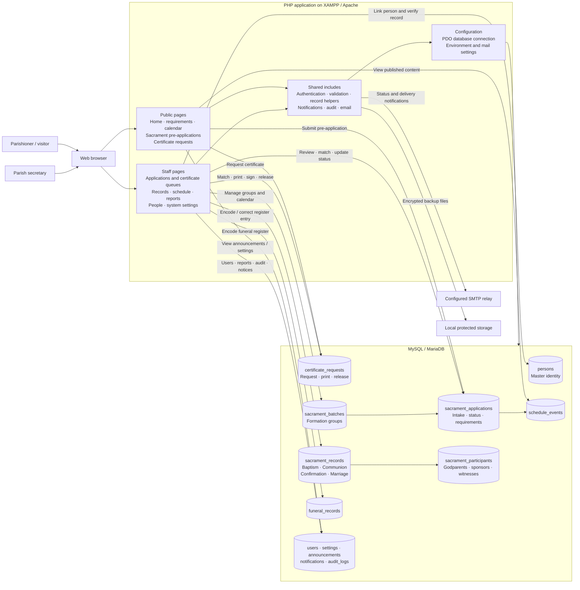
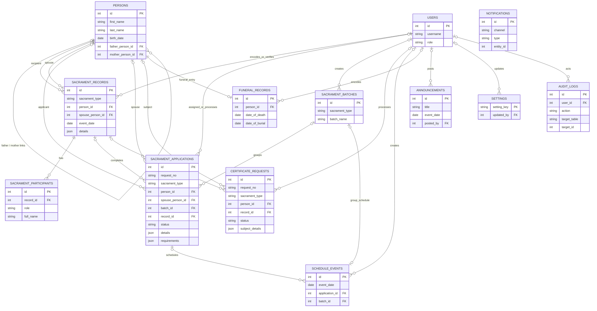

# SRS-SPPO System Graph

This graph summarizes the current local PHP application and the 13-table schema in `database/v2/schema.sql`.

## Application architecture and workflows

## Relational data model

`NOTIFICATIONS.entity_type` and `entity_id` form a polymorphic reference, so they are intentionally not shown as a foreign-key relationship. Application and certificate details are JSON snapshots; the master person and official register remain separate records.
