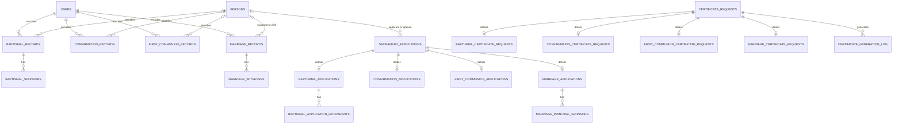

# SRS-SPPO Database Reference

This document describes the canonical MySQL/MariaDB schema in
[`srs_sppo_schema.sql`](./srs_sppo_schema.sql). The schema file is the
authoritative source if this reference and the SQL differ.

## Database overview

SRS-SPPO uses one database, `srs_sppo_db`. The four sacramental registers are
separate tables because they record different events and logbook details, but
staff-entered register rows link to the shared `persons` master identity table.
The relationship is:

```text
persons
  ├── baptismal_records
  ├── confirmation_records
  ├── first_communion_records
  └── marriage_records (husband_person_id and wife_person_id)
```

These are nullable links to support historical records and records that have
not yet been identity-matched. New staff-encoded sacramental register entries
create or reuse a master person profile. Records must be matched by staff
review; names alone are not proof that two records belong to the same person.

Public applications are stored separately as intake data. They are not
automatically treated as official register entries or automatically linked to
the person registry before staff review.

## Entity relationship map



`o|` indicates that a link may be absent. Some workflow tables use a
polymorphic `(entity_type, entity_id)` pair rather than a database foreign key;
those links are described below.

## Table directory

### Identity and sacramental registers

| Table | Purpose | Important links |
|---|---|---|
| `users` | Parish secretary accounts and staff identity. | Referenced by staff-action and audit columns throughout the schema. |
| `persons` | Master identity profile shared across sacramental registers. Stores structured name, birth details, parents, contact information, and baptismal status. | Referenced by `person_id` on three registers and by both person columns on marriage records. |
| `baptismal_records` | Baptismal register entry and physical book/page/line reference. Keeps source-register details, including internal-only `legitimacy`. | Optional `person_id`; staff references in `users`. |
| `baptismal_sponsors` | Godfather/godmother names and residences for a baptismal register entry. | `baptismal_record_id` → `baptismal_records.id`. |
| `confirmation_records` | Confirmation register entry, sponsor, minister, logbook reference, and optional baptismal prerequisite. | Optional `person_id`; `baptismal_record_id` → `baptismal_records.id`. |
| `first_communion_records` | First Communion register entry, minister, logbook reference, and optional baptismal prerequisite. | Optional `person_id`; `baptismal_record_id` → `baptismal_records.id`. |
| `marriage_records` | Marriage register entry, the two parties, witnesses reference, and physical logbook details. | `husband_person_id` and `wife_person_id` → `persons.id`. |
| `marriage_witnesses` | Witness names and residences for a marriage register entry. | `marriage_record_id` → `marriage_records.id`. |

### Certificate requests

`certificate_requests` stores shared requester/contact data, sacrament type,
tracking number, submission channel, status, staff review, and manual payment
timestamps (no amount is stored). Each request has a matching extension table
for sacrament-specific search details:

| Table | Purpose | Important links |
|---|---|---|
| `certificate_requests` | Shared certificate-request record and workflow state. | `processed_by` → `users.id`. |
| `baptismal_certificate_requests` | Baptismal subject, parents, event and logbook details supplied for matching. | `request_id` → `certificate_requests.id`; optional matched baptismal register row. |
| `confirmation_certificate_requests` | Confirmation subject, parents, baptism provenance, event and logbook details. | `request_id` → `certificate_requests.id`; optional matched confirmation register row. |
| `first_communion_certificate_requests` | First Communion subject, parents, event and logbook details. | `request_id` → `certificate_requests.id`; optional matched First Communion register row. |
| `marriage_certificate_requests` | Party A and B details, baptism details, marriage date, and register reference for matching. | `request_id` → `certificate_requests.id`; optional matched marriage register row. |

Each extension's `request_id` is unique, so it is a one-to-one detail row for a
shared certificate request. `matched_record_id` is nullable until staff verify
the corresponding register entry.

### Sacrament applications

`sacrament_applications` stores shared tracking and workflow state. The
corresponding extension table contains the details for that sacrament:

| Table | Purpose | Important links |
|---|---|---|
| `sacrament_applications` | Shared application tracking number, channel, sacrament type, status, processing, and manual payment timestamps. | `processed_by` → `users.id`; optional `person_id` and `spouse_person_id` links → `persons.id`. |
| `baptismal_applications` | Child, parent/guardian, contact, preferred date, and baptismal preparation data. | `application_id` → `sacrament_applications.id`. |
| `baptismal_application_godparents` | Godparent names, residence, and godfather/godmother type for an application. | `baptismal_application_id` → `baptismal_applications.id`. |
| `confirmation_applications` | Applicant, guardian, school, baptism provenance, preparation requirements, and sponsor data. | Shared application; optional baptismal register prerequisite. |
| `first_communion_applications` | Applicant, guardian, baptismal prerequisite, batch, and preparation status. | Shared application; optional baptismal register prerequisite. |
| `marriage_applications` | Groom/bride intake profiles, contact, sacramental documentation, preparation, banns, and preferred ceremony details. | Shared application; optional baptismal register rows for each party. |
| `marriage_principal_sponsors` | Principal sponsor names and residences for a marriage application. | `marriage_application_id` → `marriage_applications.id`. |

Application forms contain intake snapshots; this is intentionally separate
from an official sacramental register entry. On review and registration,
staff can link the applicant (and, for marriage, the other party) to the
master person. The application remains an intake snapshot; encoding into the
official register is a separate staff action.

### Scheduling, output, and workflow support

| Table | Purpose | Important links |
|---|---|---|
| `sacrament_eligibility_settings` | Configurable minimum/maximum ages for First Communion and Confirmation; ages are guidance, not automatic rejection. | `updated_by` → `users.id`. |
| `schedule_events` | Parish calendar events and optional request association. | `created_by` → `users.id`; request association is stored as a type/id pair. |
| `announcements` | Public-site announcements and publication state. | `posted_by` → `users.id`. |
| `certificate_generation_log` | Certificate generation, printing, pickup, ID-check, and superseded-copy history. | Request and staff-action links. |
| `correction_requests` | Publicly submitted requests to correct an issued certificate. | `certificate_id` is an application-level certificate reference, not a declared SQL foreign key. |
| `workflow_requirements` | Requirement checklist statuses for a certificate request or sacrament application. It tracks verification without storing uploaded documents. | Polymorphic `(entity_type, entity_id)`; `reviewed_by` → `users.id`. |
| `notifications` | Shared staff notification feed. | In-app link path; no entity foreign key. |
| `email_delivery_log` | Sent, failed, disabled, or invalid notification delivery attempts. | Optional `sent_by` → `users.id`; entity reference uses a type/id pair. |

### Administration, auditing, and system support

| Table | Purpose | Important links |
|---|---|---|
| `audit_logs` | Staff action history, target, request metadata, and optional reason. | Optional `user_id` → `users.id`. |
| `submission_rate_limits` | Rolling public-form submission counters by email and IP address. | No foreign keys; rows are disposable rate-limit data. |
| `site_settings` | Secretary-managed public page key/value content. | `updated_by` is a staff reference; the canonical DDL does not declare a foreign key. |
| `password_reset_tokens` | Hashed, expiring password-reset tokens and attempt counts for staff users. | `user_id` → `users.id`. |
| `srs_schema_migrations` | Records database upgrades applied through the protected upgrade workflow. | `applied_by` records the actor ID; canonical DDL does not declare a foreign key. |

## Master person fields

The `persons` table is the shared source for reusable identity information:

| Column | Meaning |
|---|---|
| `id` | Primary key for this person identity. |
| `first_name`, `middle_name`, `last_name`, `suffix` | Structured name parts. |
| `maiden_name` | Maiden name when applicable. |
| `sex` | Optional recorded sex (`male` or `female`). |
| `birth_date`, `birth_place` | Optional birth details. |
| `father_name`, `mother_maiden_name` | Reusable parent details. |
| `address`, `contact_number`, `email` | Optional contact/profile information. |
| `baptismal_status` | Optional status: Catholic baptism, non-Catholic baptism, or unbaptized. |
| `created_at`, `updated_at` | Profile creation and last update timestamps. |

Register tables retain event-specific values (such as date received, sponsor,
minister, and book/page/line). The person profile is not a replacement for the
physical register or a location for sacrament-specific event facts.

## Data integrity and lifecycle notes

- Master-person foreign keys on register tables use `ON DELETE SET NULL`.
  Deleting a profile therefore does not delete the physical-register index
  entry. Staff should preserve the identity link whenever possible.
- Sponsor and witness child rows use `ON DELETE CASCADE` when their parent
  register/application entry is deleted.
- Certificate requests and sacrament applications share common workflow
  fields in a parent table and keep sacrament-specific data in extension
  tables.
- `workflow_requirements`, notifications, email logs, and schedule links use
  type/id references where the schema does not declare a direct foreign key.
- No monetary amount is stored. Payment is represented only by staff-recorded
  status/timestamps.
- Online submissions are intake records, not official sacramental register
  entries. Staff review and verification remain necessary.
- `baptismal_records.legitimacy` is internal-only and must not be exposed in
  public pages, reports, or certificates.

## Setup and migration

- For a new empty database, import [`srs_sppo_schema.sql`](./srs_sppo_schema.sql).
- For a small, non-resetting walkthrough dataset, use
  [`seed_process_demo.sql`](./seed_process_demo.sql) after the current schema
  is installed. It can be rerun and does not reset application statuses.
- For a broader defense dataset, use
  [`seed_defense_demo.sql`](./seed_defense_demo.sql) and follow the
  [demo walkthrough](../docs/DEMO_WALKTHROUGH.md). It adds fictional linked
  sample records without deleting data or overwriting existing workflow
  statuses. It does not create login accounts.
- For an existing database, inspect its current schema, back it up, and apply
  only reviewed upgrade scripts. Do not import the full schema over existing
  data.
- Migration `039_master_person_profile.sql` adds the reusable parent fields
  and backfills only blank values from already linked register records. It
  does not automatically identify or merge duplicate people.
- Migration `045_link_sacrament_applications_to_persons.sql` adds staff-
  confirmed person links to applications, with a second party link for
  marriage. Existing application rows remain unlinked until reviewed.
- Migration `046_confirmation_application_profile_fields.sql` adds optional
  identity, family, and preparation fields to existing Confirmation
  applications to match the canonical schema.
- For the upgrade process and compatibility notes, see
  [`README_MIGRATION.md`](../migrations/README_MIGRATION.md).
