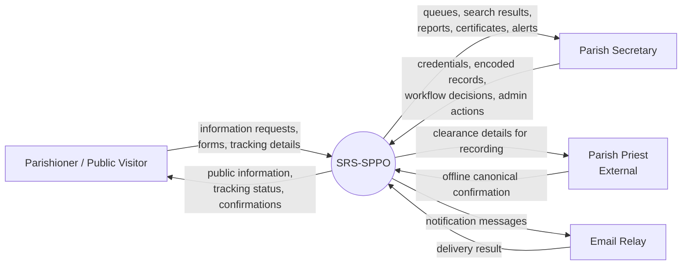
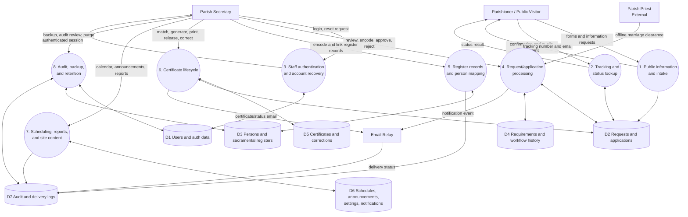

# SRS-SPPO System Analysis Diagrams

This document describes the current implementation of the Saint Patrick's
Parish Office Schedule and Record System. The diagrams use Mermaid syntax,
which can be rendered by GitHub, VS Code Markdown Preview, or Mermaid Live.

## 1. Entity-Relationship Diagram

The system uses shared parent tables for certificate requests and sacrament
applications, with one extension table per sacrament. Sacramental register
records are separate from applications and requests because they represent
the parish's digitized physical registers.

```mermaid
erDiagram
    USERS {
        int id PK
        string full_name
        string username UK
        string email UK
        string password_hash
        enum role
        boolean is_active
        int auth_version
        datetime created_at
    }

    PERSONS {
        int id PK
        string first_name
        string middle_name
        string last_name
        string suffix
        string maiden_name
        enum sex
        date birth_date
        string address
        string contact_number
        string email
        enum baptismal_status
    }

    BAPTISMAL_RECORDS {
        int id PK
        string entry_no
        date baptism_date
        string child_full_name
        date birth_date
        int encoded_by FK
        int person_id FK
        int book_verified_by FK
    }

    BAPTISMAL_SPONSORS {
        int id PK
        int baptismal_record_id FK
        string sponsor_name
        string sponsor_residence
        enum sponsor_type
    }

    CONFIRMATION_RECORDS {
        int id PK
        string entry_no
        date confirmation_date
        string confirmand_full_name
        int baptismal_record_id FK
        int encoded_by FK
        int person_id FK
    }

    FIRST_COMMUNION_RECORDS {
        int id PK
        string entry_no
        date communion_date
        string communicant_full_name
        int baptismal_record_id FK
        int encoded_by FK
        int person_id FK
    }

    MARRIAGE_RECORDS {
        int id PK
        string entry_no
        date marriage_date
        string groom_name
        string bride_name
        int encoded_by FK
        int groom_person_id FK
        int bride_person_id FK
    }

    MARRIAGE_WITNESSES {
        int id PK
        int marriage_record_id FK
        string witness_name
        string witness_residence
    }

    CERTIFICATE_REQUESTS {
        int id PK
        string tracking_number UK
        enum sacrament_type
        string requester_name
        string requester_email
        enum status
        int created_by FK
        int paid_by FK
    }

    SACRAMENT_APPLICATIONS {
        int id PK
        string tracking_number UK
        enum sacrament_type
        string applicant_name
        string applicant_email
        enum status
        int created_by FK
    }

    BAPTISMAL_CERTIFICATE_REQUESTS {
        int id PK
        int certificate_request_id FK
        string subject_name
        date birth_date
    }

    CONFIRMATION_CERTIFICATE_REQUESTS {
        int id PK
        int certificate_request_id FK
        string confirmand_name
        date birthdate
    }

    FIRST_COMMUNION_CERTIFICATE_REQUESTS {
        int id PK
        int certificate_request_id FK
        string communicant_name
        date birthdate
    }

    MARRIAGE_CERTIFICATE_REQUESTS {
        int id PK
        int certificate_request_id FK
        string groom_name
        string bride_name
        date marriage_date
    }

    BAPTISMAL_APPLICATIONS {
        int id PK
        int application_id FK
        string child_name
        date preferred_date
    }

    CONFIRMATION_APPLICATIONS {
        int id PK
        int application_id FK
        string confirmand_name
        date preferred_date
    }

    FIRST_COMMUNION_APPLICATIONS {
        int id PK
        int application_id FK
        string communicant_name
        date preferred_date
    }

    MARRIAGE_APPLICATIONS {
        int id PK
        int application_id FK
        string groom_name
        string bride_name
        date preferred_date
        boolean precana_completed
        boolean canonical_interview_completed
    }

    BAPTISMAL_APPLICATION_GODPARENTS {
        int id PK
        int baptismal_application_id FK
        string godparent_name
    }

    MARRIAGE_PRINCIPAL_SPONSORS {
        int id PK
        int marriage_application_id FK
        string sponsor_name
    }

    CERTIFICATE_GENERATION_LOG {
        int id PK
        int certificate_request_id FK
        int generated_by FK
        int printed_by FK
        enum status
        datetime created_at
    }

    CORRECTION_REQUESTS {
        int id PK
        string tracking_number
        int certificate_id FK
        string requester_email
        enum status
    }

    WORKFLOW_REQUIREMENTS {
        int id PK
        enum entity_type
        int entity_id
        string requirement_key
        enum status
        int reviewed_by FK
    }

    SCHEDULE_EVENTS {
        int id PK
        string title
        datetime starts_at
        datetime ends_at
        enum event_type
        int created_by FK
    }

    ANNOUNCEMENTS {
        int id PK
        string title
        text body
        boolean is_published
        int created_by FK
    }

    AUDIT_LOGS {
        int id PK
        int user_id FK
        enum role_snapshot
        string action
        string target_table
        int target_id
        datetime created_at
    }

    EMAIL_DELIVERY_LOG {
        int id PK
        string recipient
        string event_type
        string entity_type
        int entity_id
        enum delivery_status
        int sent_by FK
    }

    NOTIFICATIONS {
        int id PK
        enum type
        string title
        string link
        boolean is_read
        datetime created_at
    }

    PASSWORD_RESET_TOKENS {
        int id PK
        int user_id FK
        string token_hash
        datetime expires_at
        datetime used_at
    }

    SITE_SETTINGS {
        int setting_id PK
        string setting_key UK
        text setting_value
        int updated_by FK
    }

    SACRAMENT_ELIGIBILITY_SETTINGS {
        int id PK
        enum sacrament_type UK
        int min_age
        int max_age
    }

    SUBMISSION_RATE_LIMITS {
        int id PK
        string email
        string ip_address
        string form_type
        datetime submitted_at
    }

    USERS ||--o{ BAPTISMAL_RECORDS : encodes
    USERS ||--o{ CONFIRMATION_RECORDS : encodes
    USERS ||--o{ FIRST_COMMUNION_RECORDS : encodes
    USERS ||--o{ MARRIAGE_RECORDS : encodes
    USERS ||--o{ CERTIFICATE_REQUESTS : creates
    USERS ||--o{ SACRAMENT_APPLICATIONS : creates
    USERS ||--o{ AUDIT_LOGS : performs
    USERS ||--o{ PASSWORD_RESET_TOKENS : receives
    USERS ||--o{ SCHEDULE_EVENTS : creates
    USERS ||--o{ ANNOUNCEMENTS : creates
    USERS ||--o{ WORKFLOW_REQUIREMENTS : reviews
    USERS ||--o{ EMAIL_DELIVERY_LOG : sends

    PERSONS ||--o{ BAPTISMAL_RECORDS : links
    PERSONS ||--o{ CONFIRMATION_RECORDS : links
    PERSONS ||--o{ FIRST_COMMUNION_RECORDS : links
    PERSONS ||--o{ MARRIAGE_RECORDS : groom
    PERSONS ||--o{ MARRIAGE_RECORDS : bride

    BAPTISMAL_RECORDS ||--o{ BAPTISMAL_SPONSORS : has
    BAPTISMAL_RECORDS ||--o{ CONFIRMATION_RECORDS : prerequisite
    BAPTISMAL_RECORDS ||--o{ FIRST_COMMUNION_RECORDS : prerequisite
    MARRIAGE_RECORDS ||--o{ MARRIAGE_WITNESSES : has

    CERTIFICATE_REQUESTS ||--o| BAPTISMAL_CERTIFICATE_REQUESTS : details
    CERTIFICATE_REQUESTS ||--o| CONFIRMATION_CERTIFICATE_REQUESTS : details
    CERTIFICATE_REQUESTS ||--o| FIRST_COMMUNION_CERTIFICATE_REQUESTS : details
    CERTIFICATE_REQUESTS ||--o| MARRIAGE_CERTIFICATE_REQUESTS : details
    CERTIFICATE_REQUESTS ||--o{ CERTIFICATE_GENERATION_LOG : generates
    CERTIFICATE_REQUESTS ||--o{ WORKFLOW_REQUIREMENTS : checks
    CERTIFICATE_REQUESTS ||--o{ EMAIL_DELIVERY_LOG : notifies

    SACRAMENT_APPLICATIONS ||--o| BAPTISMAL_APPLICATIONS : details
    SACRAMENT_APPLICATIONS ||--o| CONFIRMATION_APPLICATIONS : details
    SACRAMENT_APPLICATIONS ||--o| FIRST_COMMUNION_APPLICATIONS : details
    SACRAMENT_APPLICATIONS ||--o| MARRIAGE_APPLICATIONS : details
    SACRAMENT_APPLICATIONS ||--o{ WORKFLOW_REQUIREMENTS : checks
    SACRAMENT_APPLICATIONS ||--o{ EMAIL_DELIVERY_LOG : notifies

    BAPTISMAL_APPLICATIONS ||--o{ BAPTISMAL_APPLICATION_GODPARENTS : has
    MARRIAGE_APPLICATIONS ||--o{ MARRIAGE_PRINCIPAL_SPONSORS : has
    CERTIFICATE_REQUESTS ||--o{ CORRECTION_REQUESTS : corrects
```

### Supporting tables

`site_settings`, `notifications`, `sacrament_eligibility_settings`, and
`submission_rate_limits` support the application but do not represent the
core sacramental record relationships. `audit_logs` and
`email_delivery_log` are append-oriented history tables. The
`workflow_requirements` table intentionally uses a polymorphic
`entity_type`/`entity_id` pair so the same checklist can support both
certificate requests and sacrament applications.

## 2. Data Normalization

The schema is designed to be in **Third Normal Form (3NF)** for the main
transactional data.

### First Normal Form (1NF)

- Every table has a primary key.
- Columns contain single values rather than repeating groups.
- Repeating people are moved into child tables:
  - `baptismal_sponsors`
  - `baptismal_application_godparents`
  - `marriage_witnesses`
  - `marriage_principal_sponsors`
- Repeating workflow requirements are represented as rows in
  `workflow_requirements`, not as columns such as `requirement_1`,
  `requirement_2`, and `requirement_3`.

### Second Normal Form (2NF)

- The tables use single-column surrogate primary keys, so non-key attributes
  depend on the whole primary key.
- Sacrament-specific attributes are separated from shared request/application
  attributes. For example, requester identity and status belong in
  `certificate_requests`, while baptism-specific details belong in
  `baptismal_certificate_requests`.
- Sponsor and witness attributes depend on their own row and foreign key, not
  on an unrelated certificate or application field.

### Third Normal Form (3NF)

- User credentials and account state are stored once in `users`; transaction
  rows reference the user through foreign keys such as `created_by`,
  `encoded_by`, `reviewed_by`, and `sent_by`.
- Shared person identity is centralized in `persons`, reducing repeated
  identity data across sacramental records.
- Eligibility rules are stored in `sacrament_eligibility_settings` rather
  than hard-coded on every applicant row.
- Public-page content is stored as key/value rows in `site_settings`, so page
  content is not duplicated across templates.
- Status, audit, notification, and delivery histories are separate from the
  business entity they describe.

### Deliberate implementation trade-offs

- `workflow_requirements` uses a polymorphic reference because one checklist
  supports two different parent tables. MySQL cannot enforce a conventional
  foreign key across both possible parent tables, so application code must
  validate `entity_type` and `entity_id`.
- Some register tables retain denormalized display-name fields such as
  `child_full_name`, `confirmand_full_name`, `groom_name`, and `bride_name`.
  This preserves the exact historical wording from the physical parish
  register and supports certificate printing. The optional `persons` links
  provide cross-record identity mapping without replacing the historical
  snapshot.
- `audit_logs.target_table` and `target_id` are intentionally generic so one
  audit table can describe changes across many modules. This is appropriate
  for append-only audit history but is not a normal business foreign key.

## 3. Use-Case Diagram

### Actors

- **Parishioner / Public Visitor** — views information, submits public
  certificate or sacrament forms, and tracks an existing transaction.
- **Parish Secretary** — the only authenticated staff role; manages records,
  requests, applications, certificates, schedules, accounts, reports, audit
  history, backups, and retention.

```mermaid
flowchart LR
    subgraph system["SRS-SPPO"]
        direction TB
        information((View Parish<br/>Information))
        certificate_request((Submit Certificate<br/>Request))
        sacrament_application((Submit Sacrament<br/>Application))
        tracking((Track Request<br/>Status))
        login((Log In / Recover<br/>Password))
        intake((Review Queue / Encode<br/>Walk-In Request))
        records((Manage Sacramental<br/>Records))
        requirements((Review Requirements<br/>and Status))
        certificates((Generate / Print /<br/>Release Certificate))
        schedule((Manage Schedule /<br/>Announcements))
        reports((View Reports))
        system_tools((Manage Accounts /<br/>Backup / Audit))
    end

    public(("👤<br/>PARISHIONER /<br/>PUBLIC VISITOR"))
    secretary(("👤<br/>PARISH<br/>SECRETARY"))

    public --- information
    public --- certificate_request
    public --- sacrament_application
    public --- tracking
    secretary --- login
    secretary --- intake
    secretary --- records
    secretary --- requirements
    secretary --- certificates
    secretary --- schedule
    secretary --- reports
    secretary --- system_tools

    style public fill:#ffffff,stroke:#ffffff,color:#111827
    style secretary fill:#ffffff,stroke:#ffffff,color:#111827
    style information fill:#ffffff,stroke:#15803d,color:#111827
    style certificate_request fill:#ffffff,stroke:#15803d,color:#111827
    style sacrament_application fill:#ffffff,stroke:#15803d,color:#111827
    style tracking fill:#ffffff,stroke:#15803d,color:#111827
    style login fill:#ffffff,stroke:#15803d,color:#111827
    style intake fill:#ffffff,stroke:#15803d,color:#111827
    style records fill:#ffffff,stroke:#15803d,color:#111827
    style requirements fill:#ffffff,stroke:#15803d,color:#111827
    style certificates fill:#ffffff,stroke:#15803d,color:#111827
    style schedule fill:#ffffff,stroke:#15803d,color:#111827
    style reports fill:#ffffff,stroke:#15803d,color:#111827
    style system_tools fill:#ffffff,stroke:#15803d,color:#111827
```

Only people who directly use SRS-SPPO are shown as use-case actors. External
services such as the email relay and database are excluded from this diagram;
the priest's offline confirmation is not a direct system interaction.

## 4. Data-Flow Diagram

### Context-level DFD

### Level-1 DFD

### Main data stores

| Store | Main tables | Purpose |
|---|---|---|
| D1 | `users`, `password_reset_tokens` | Staff authentication and account recovery |
| D2 | `certificate_requests`, sacrament request extensions, `sacrament_applications`, application extensions | Public and walk-in transactions |
| D3 | `persons`, four register tables, sponsors, witnesses | Digitized parish register data |
| D4 | `workflow_requirements`, application/request status fields | Documentary and workflow review |
| D5 | `certificate_generation_log`, `correction_requests` | Certificate production and correction history |
| D6 | `schedule_events`, `announcements`, `site_settings`, `notifications` | Public content and office coordination |
| D7 | `audit_logs`, `email_delivery_log`, `submission_rate_limits` | Accountability, delivery history, and abuse controls |

## 5. Important System Boundary

The priest is not an authenticated application user. Marriage canonical
interviews, priest confirmation, and related offline decisions are performed
outside SRS-SPPO. The parish secretary records the resulting decision and
notes in the system. Similarly, payment is outside the system; only a manual
status and timestamp are retained where required by the workflow.
